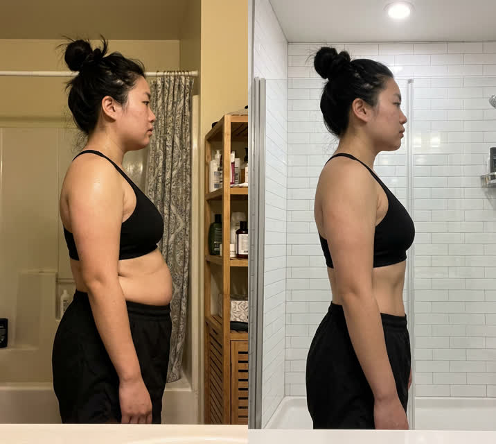
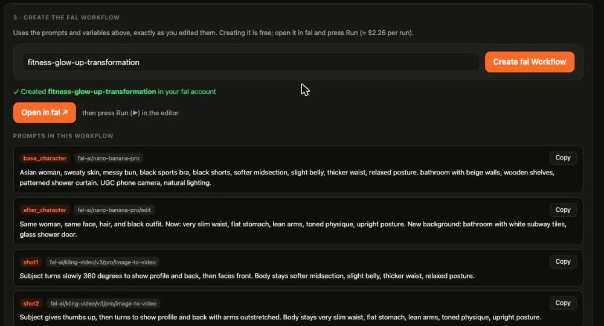

<div align="center">

# REH: Reverse Engineer Higgsfield

### Upload an AI video. Get the fal.ai flow that makes it. Scale the format.

**A single Rust binary: CLI, local web app and MCP server. Every claim is either measured from the file or labeled as inferred.**

`reh analyze video.mp4` → `reh build flow.json` → `reh verify` → `reh batch`

**New here? Follow the [step-by-step guide](docs/GUIDE.md)**: fal key → drop a video → fal Workflow with every prompt filled in.

Built by [**DansUGC**](https://dansugc.com/?utm_source=github&utm_medium=oss&utm_campaign=reverse-engineer-higgsfield): real human UGC creators for your ads, from $5 a clip.

</div>

---

Everyone is making AI videos on Higgsfield. The formats that go viral (before/after transformations, AI UGC talking heads, camera-preset shots, product orbits) are repeatable recipes: a first frame, an identity-preserving edit, a few image-to-video shots, captions, a hard cut. REH takes any one of those videos apart and writes the recipe as a **fal.ai flow** you can run, edit, publish as a fal Workflow, and batch across new characters, products and captions.

Inspired by [REA (Reverse Engineer Anything)](https://github.com/morluto/rea) (its evidence-first approach and the investigate → spec → build → verify loop), applied to AI video.

## What it does

```
video.mp4
  │  investigate   ffprobe + scene detection + keyframes            (measured, no key)
  │                + a video model reads every shot via fal          (inferred, labeled)
  ▼
flow.json          text_to_image → image_edit (same character) → image_to_video per shot
  │                + edit: trim to the original cuts, captions, music
  │  spec          variables: {{character}} {{setting}} {{caption}} …
  ▼
reh build          runs on fal (queue API), downloads every output, assembles rebuild.mp4
reh verify         structure check + a video-model judge → prompt fixes → flow.v2.json
reh batch          one rebuild per line of variants.jsonl, within a budget
reh publish        the same flow as a native fal Workflow
```

For example, a Higgsfield before/after "watch me lock in for 3 months" video comes out as ([full report](examples/before-after-transformation/REPORT.md), [flow.json](examples/before-after-transformation/flow.json)):

| Step | fal model | Why |
|---|---|---|
| `base_image_before` text-to-image | `fal-ai/nano-banana-pro` | the "before" first frame, 9:16, body described concretely |
| `base_image_after` image edit | `fal-ai/nano-banana-pro/edit` | same person, written as a list of changes so the "after" really changes |
| `shot1` image-to-video | `fal-ai/kling-video/v3/pro/image-to-video` | slow side-profile turn, 7.07s |
| `shot2` image-to-video | `fal-ai/kling-video/v3/pro/image-to-video` | thumbs up + arms out, 5.96s |
| edit | local ffmpeg | hard cut at 7.07s, caption "{{caption_text}}" 0–7.07s, your music |

About $2.26 per run at fal's live prices. The two stills from that flow (AI-generated):

<p align="center"></p>

## Quick start

Requirements: [Rust](https://rustup.rs) 1.87+, `ffmpeg`, and a [fal.ai key](https://fal.ai/dashboard/keys).

```bash
git clone https://github.com/dansugc/reverse-engineer-higgsfield && cd reverse-engineer-higgsfield
cargo install --path .          # installs `reh`
echo 'FAL_KEY=your_key' > .env  # never commit it; .env is gitignored

reh demo                        # a finished teardown, no key needed
reh analyze my_video.mp4        # → reh-runs/<name>/REPORT.md + flow.json + workflow.fal.json
reh plan reh-runs/<name>/flow.json
reh build reh-runs/<name>/flow.json --max-usd 5 --music my_track.mp3
reh verify my_video.mp4 reh-runs/<build>/rebuild.mp4 --flow reh-runs/<name>/flow.json --apply
```

No key? `reh analyze video.mp4 --no-ai` still measures shots, cut timing, keyframes, audio and provenance, and writes a skeleton flow.

### Web app

```bash
reh web          # http://localhost:4400
```

1. **Paste your fal key** in the app. It's checked with fal, optionally saved to a local `.env` with owner-only permissions, and never sent back to the page.
2. **Drop a video.** You see the measured shots with keyframes, what the video model read in each shot, the editable variables and prompts, and a live cost estimate.
3. **Create fal Workflow.** One click creates it in your fal account with your edited prompts in every node, then gives you an **Open in fal** link and each prompt with a Copy button. Or press **Rebuild on fal** to render it here with captions and the original cut timing, side by side with the original.

<p align="center"></p>

The server listens on localhost only. Full walkthrough: [docs/GUIDE.md](docs/GUIDE.md).

### Scale a format

```jsonl
{"character": "a man in his 30s with a beard", "caption": "day 1 vs day 90"}
{"character": "a woman in her 40s, curly hair", "caption": "watch me lock in for 3 months"}
```

```bash
reh batch flow.json --vars variants.jsonl --max-usd 20
```

### Use it from your agent (MCP)

```bash
claude mcp add reh -- reh mcp
codex mcp add reh -- reh mcp
```

| Tool | |
|---|---|
| `analyze_video` | investigate → flow.json + REPORT.md + fal Workflow JSON |
| `plan_flow` | steps + cost, no spending |
| `get_flow` | read a flow to edit it |
| `build_flow` | **spends credits**: requires `confirm: true` and a `max_usd` budget |
| `verify_rebuild` | structure + judge + fixes (`apply` writes flow.v2.json) |
| `publish_workflow` | create the flow as a fal Workflow |
| `get_playbook` | the analyst instructions (evidence rules, format catalog, model guide) |

Guided prompts: `investigate_video`, `rebuild_on_fal` (investigate → spec → build → verify), `scale_format`.

## Evidence, not vibes

- **Measured** (from the file): duration, resolution, fps, shot boundaries, cut timing, audio, container tags, C2PA / generator markers.
- **Inferred** (from a video model reading the pixels, always labeled): subject, setting, camera, motion, on-screen text, which tool likely made it.
- **Unknown** (always listed): the exact prompt, seed, and model are **not in the file**. Higgsfield (and TikTok re-encodes) don't store them. REH rebuilds the *format*, not identical pixels, and `reh verify` measures how close it got.

## Models

Defaults are picked per step and can be changed in `flow.json`. Each step lists its `why`.

| Step | Default | Alternatives |
|---|---|---|
| read the video | `google/gemini-3.1-pro-preview` via `openrouter/router/video` | `--model google/gemini-3.8-flash` (cheaper) |
| text-to-image | `fal-ai/nano-banana-pro` | `bytedance/seedream/v5/pro/text-to-image` |
| image edit (identity) | `fal-ai/nano-banana-pro/edit` | `bytedance/seedream/v5/pro/edit` |
| image-to-video | `fal-ai/kling-video/v3/pro/image-to-video` | `bytedance/seedance-2.5/us/image-to-video`, `fal-ai/minimax/hailuo-2.3/pro/image-to-video`, Kling v3 Standard |

Durations are clamped to each model's range and trimmed back to the original cut at assembly. Cost comes from fal's live pricing API whenever a key is set. Every build checks its cost against `--max-usd` before spending anything.

## Use it responsibly

Rebuild **formats**, not people. Don't use REH to recreate a real person's face, body or voice, or someone else's characters or brand. Use your own or fully AI-generated characters. Label AI content where platforms require it (TikTok, Instagram and YouTube all do). Music in the original is usually a licensed or trending sound, so add your own licensed track.

## Develop

```bash
cargo test        # includes a real-ffmpeg assembly test
cargo run -- analyze video.mp4 --no-ai
```

The harness (the analyst's instructions) lives in `harness/*.md`, is compiled into the binary, and its SHA is stamped on every report. Change a prompt, re-run, compare.

## Built by DansUGC

REH finds the AI video formats that work. When you need **real human creators** for the ads around them (UGC reactions, testimonials, b-roll), that's [DansUGC](https://dansugc.com/?utm_source=github&utm_medium=oss&utm_campaign=reverse-engineer-higgsfield): 5,000+ real-creator clips and custom videos from $5 a clip.

Also by us: [REM: Reverse Engineer Marketing](https://github.com/dansugc/reverse-engineer-marketing). Paste a link and get a company's whole marketing machine.

## License

MIT
