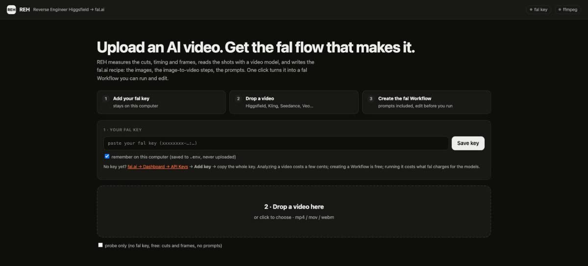

# Guide: from a video to a fal Workflow

This guide takes you from "I saw a great AI video" to a **fal Workflow with all the prompts filled in**, ready to run. About 10 minutes the first time, 2 minutes after that.

**You will:** 1. get a fal key → 2. install REH → 3. open the app and add your key → 4. drop a video → 5. create the fal Workflow → 6. run it in fal.

<p align="center"></p>

---

## 1. Get a fal key

REH runs every AI step on [fal.ai](https://fal.ai): reading your video, and later generating the images and videos.

1. Sign up at [fal.ai](https://fal.ai) and add some credit under **Billing**. $10 is plenty to try REH a few times.
2. Open [fal.ai → Dashboard → API Keys](https://fal.ai/dashboard/keys) and press **Add key**.
3. Copy the **whole** key. It looks like `xxxxxxxx-xxxx-xxxx-xxxx-xxxxxxxxxxxx:xxxxxxxxxxxxxxxx`, with a colon in the middle. Copy both parts.

The key is only shown once. If you lose it, delete it and make a new one.

What things cost:

| Action | Cost |
|---|---|
| Analyze a video (a video model reads every shot) | a few cents |
| Create the fal Workflow | free |
| Run the Workflow in fal (2 images + 2 Kling shots, ~13s) | about $2–3, shown before you run |

## 2. Install REH

You need **Rust** (to build REH) and **ffmpeg** (to measure the video).

**macOS**
```bash
brew install ffmpeg rustup && rustup-init -y && source ~/.cargo/env
```

**Linux (Debian/Ubuntu)**
```bash
sudo apt install ffmpeg && curl https://sh.rustup.rs -sSf | sh -s -- -y && source ~/.cargo/env
```

**Windows:** install [Rust](https://rustup.rs) and ffmpeg (`winget install ffmpeg`), then open a new terminal.

Then install REH:

```bash
git clone https://github.com/dansugc/reverse-engineer-higgsfield
cd reverse-engineer-higgsfield
cargo install --path .
```

The first build takes a minute or two. Check it worked with `reh doctor`.

## 3. Open the app and add your key

```bash
reh web
```

Your browser opens **http://localhost:4400**. The app only runs on your computer, and nobody else can reach it.

In box **1 · Your fal key**, paste the key and press **Save key**.

- REH checks the key with fal right away. A wrong or half-copied key gives a clear error.
- Leave **remember on this computer** ticked and the key is saved to a `.env` file in the folder you ran `reh web` from. Only your user account can read it, it's ignored by git, and it's never uploaded. Untick it to keep the key only until you close the app.
- The green **fal key** dot (top right) means you're connected. Press **Change** to use a different key.

Prefer the terminal? Put `FAL_KEY=your_key` in a `.env` file next to where you run `reh`, or `export FAL_KEY=…`.

## 4. Drop a video

Drag an mp4, mov or webm into **2 · Drop a video here**, or click it to pick a file. Higgsfield, Kling, Seedance, Veo, Sora and TikTok downloads all work.

Analysis takes about 30–90 seconds. You then see:

- **Shots (measured):** where every cut is, to the hundredth of a second, with 3 frames from each shot.
- **Variables:** the parts of the format you can swap: the character, settings, the before/after body, the caption. Change them here to make your own version.
- **The fal flow (editable):** every step, its fal model and its prompt. Edit any prompt in place.
- **Evidence / Unknowns:** what was measured from the file, what the AI inferred, and what can't be known. The original prompt, seed and model are never stored in the video file, so REH rebuilds the *format*, not the exact pixels.

Tips before you create the Workflow:

- Use **your own** character in `{{character}}`. Don't recreate a real person from the original video.
- For before/after videos, make the two states concrete ("rounded belly over the waistband" vs "flat stomach with visible ab lines"). Vague words give two near-identical images.

## 5. Create the fal Workflow

Scroll to **3 · Create the fal Workflow**, keep or change the name, and press **Create fal Workflow**.

<p align="center"></p>

REH creates it in **your** fal account with the prompts and variables exactly as you edited them, and shows:

- **Open in fal ↗**, which opens your new Workflow.
- **Every prompt**, with a **Copy** button.

If the name is already taken, REH adds `-2`, `-3`… because fal can't overwrite a Workflow. Delete old ones in fal under **Workflows**.

## 6. Run it in fal

1. Press **Open in fal ↗**. You see the graph: before image → after image (same person) → one video per shot → merge → Response.
2. Each node has its prompt filled in. Click into a node to change a prompt, duration or aspect ratio.
3. Press **Run (▶)** at the bottom. fal shows the cost estimate first.
4. When it finishes, the **Response** node has the final merged `video` and each shot's clip.

The fal Workflow generates and merges the clips. Captions and trimming each clip to the original cut timing happen in REH (next step), because fal Workflows don't do text overlays.

## 7. Optional: rebuild with captions in REH

Back in the app, **Rebuild on fal** runs the same flow, trims each clip to the original cut, burns in the captions, and shows the original and your rebuild side by side. Set **max $** first. REH won't start if the estimate is higher.

From the terminal:

```bash
reh build reh-runs/<run>/flow.json --max-usd 5 --music my_track.mp3
reh verify original.mp4 reh-runs/<run>/build-*/rebuild.mp4 --flow reh-runs/<run>/flow.json --apply
```

`verify` compares duration, aspect, shot count and cut timing, then asks a video model what's different and writes suggested prompt fixes to `flow.v2.json`.

## 8. Scale the format

Make 10 versions with different characters or captions. Write one JSON object per line:

```jsonl
{"character": "a man in his 30s with a beard", "caption_text": "day 1 vs day 90"}
{"character": "a woman in her 40s, curly hair", "caption_text": "watch me lock in for 3 months"}
```

```bash
reh batch reh-runs/<run>/flow.json --vars variants.jsonl --max-usd 20
```

## 9. Use it from Claude Code or Codex

```bash
claude mcp add reh -- reh mcp     # or: codex mcp add reh -- reh mcp
```

Then ask: *"Reverse engineer ~/Downloads/video.mp4 and create the fal Workflow."* Anything that spends credits (`build_flow`) needs `confirm: true` and a budget.

---

## Troubleshooting

| Problem | Fix |
|---|---|
| "That doesn't look like a fal key" | Copy the whole key, including the part after the colon. |
| "fal rejected the key (401)" | The key was deleted, or your fal account has no credit. Make a new key at fal.ai → Dashboard → API Keys. |
| "fal Workflows API refused (403)" | Your key can't create Workflows. Make a new key with full API access, or download **fal workflow.json** from the result page and import it in the fal Workflow editor. |
| "Workflow with this name already exists" | REH retries with `-2`, `-3`… automatically. Delete old Workflows in fal if you want the name back. |
| The fal key dot stays grey | Press **Save key** again. Keys you didn't save with "remember" are forgotten when `reh web` stops. |
| ffmpeg dot is grey / "ffprobe not found" | Install ffmpeg (step 2) and restart `reh web`. |
| Before and after look almost the same | Make both states concrete and write the after prompt as a list of changes: "Same person, same face and outfit. Now: …". |
| The person changes between shots | Keep every video step starting from the image of the same character (`image_from`), and keep "same face" in the edit prompt. |
| Analysis says "probe only" | No key was connected, so it measured the cuts but wrote placeholder prompts. Add your key and drop the video again. |
| Port 4400 is busy | `reh web --port 4500` |

## Privacy and security

- `reh web` listens on `127.0.0.1` only and rejects requests from other sites.
- Your key goes from your browser to REH on your own computer, and from REH to fal. The app never sends it back to the page or anywhere else.
- Your videos and results stay in `reh-runs/` on your computer. Only fal sees what you send it to generate.
- If a key is ever pasted somewhere public, delete it in the fal dashboard and make a new one.

---

Built by [DansUGC](https://dansugc.com/?utm_source=github&utm_medium=oss&utm_campaign=reverse-engineer-higgsfield). When the AI version works and you want **real human creators** for your ads (UGC reactions, testimonials, b-roll), we have 5,000+ clips from $5 each.
